<p align="center">
  
</p>

<h1 align="center">Orbit Transit</h1>

<p align="center">
  <b>Bus, train and bike.</b><br>
  <a href="https://orbit.jaypengx.com/transit/"><b>orbit.jaypengx.com/transit</b></a>
</p>

<p align="center">
     
</p>

Taiwan's buses, 台鐵, 高鐵, metros and YouBike in one app, with trips planned the way people really travel. Part of **Orbit**, a family of apps for life in Taiwan that share one sign-in, the Orbit Pass. See them all at [orbit.jaypengx.com](https://orbit.jaypengx.com/pass/).

<p align="center">
  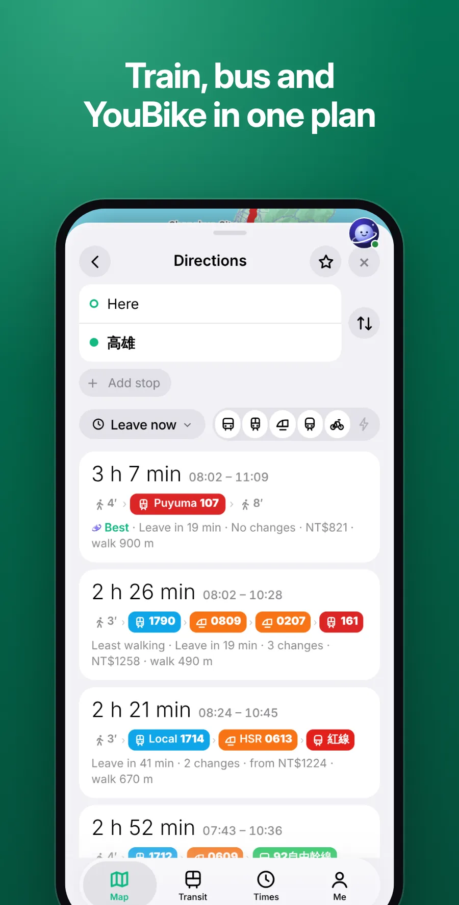
  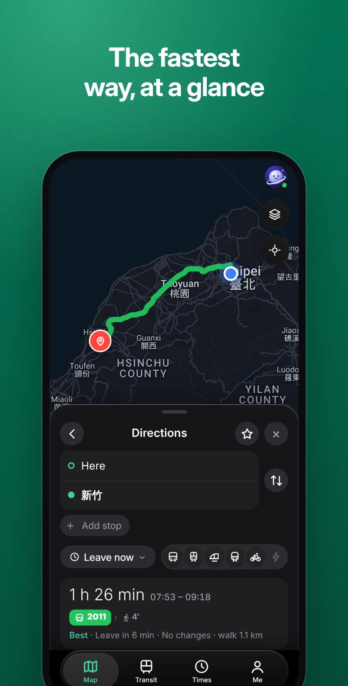
  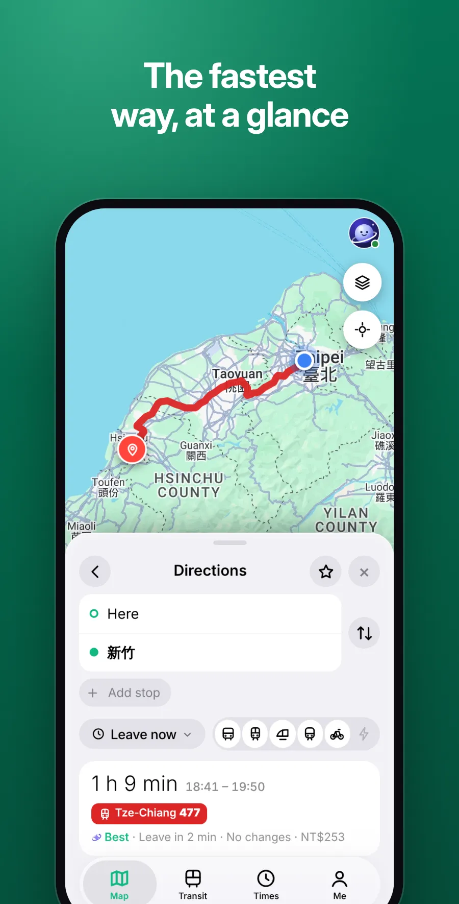
</p>

<p align="center">
  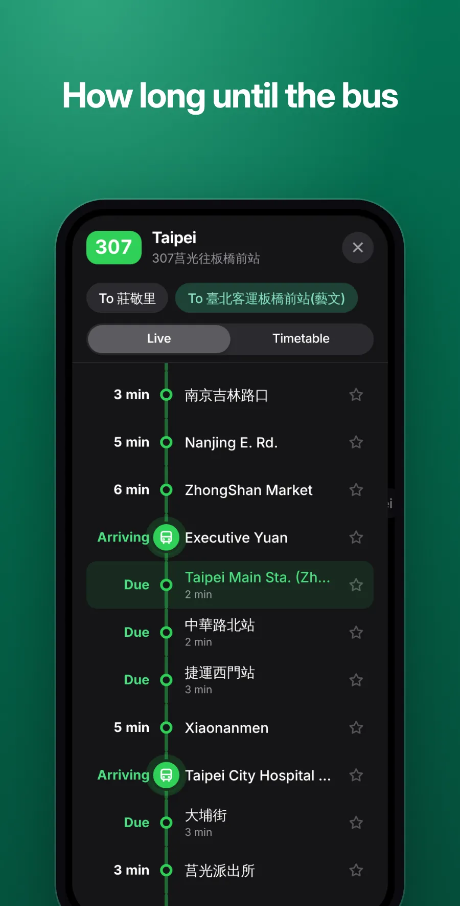
  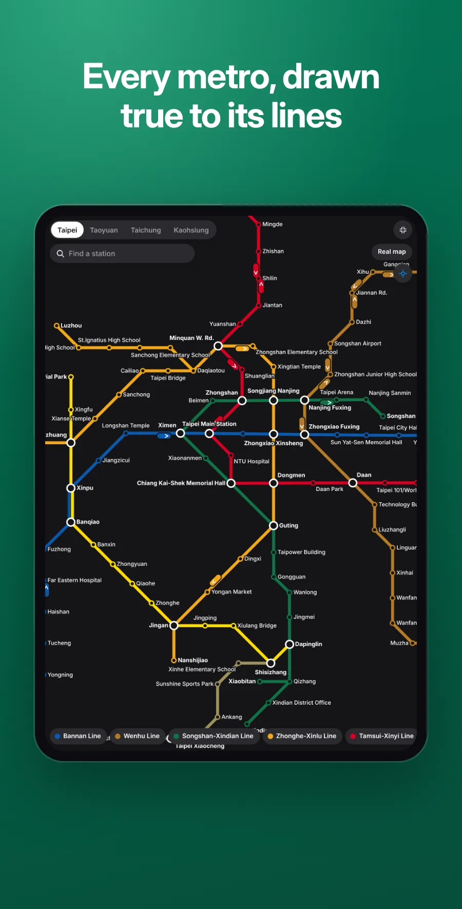
  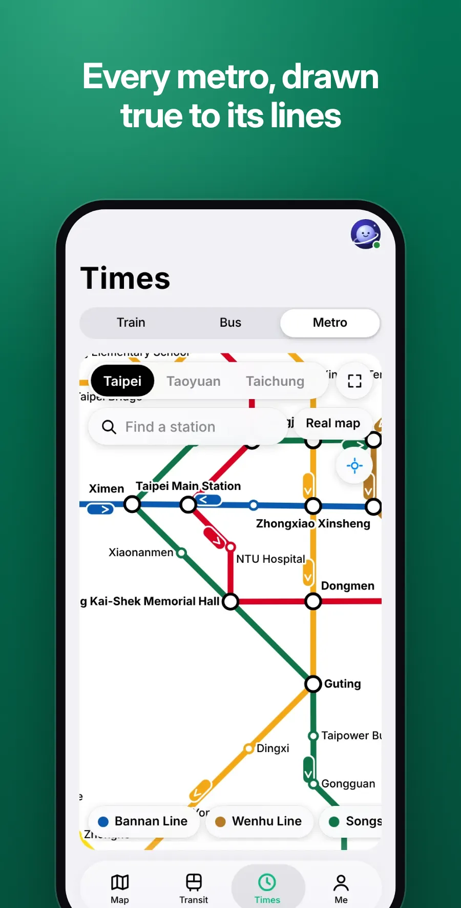
</p>

<p align="center">
  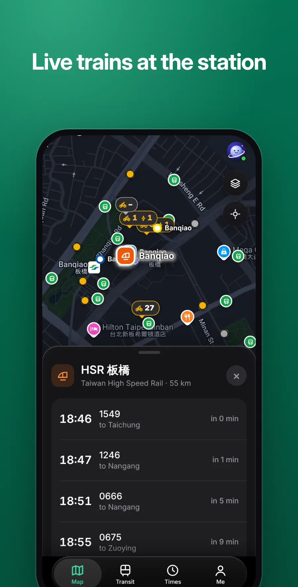
  
  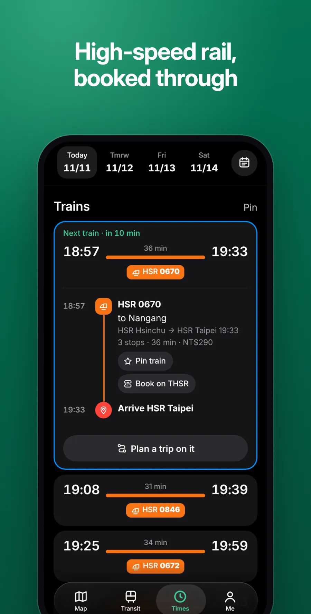
</p>

<details>
<summary>中文畫面</summary>

<p align="center">
  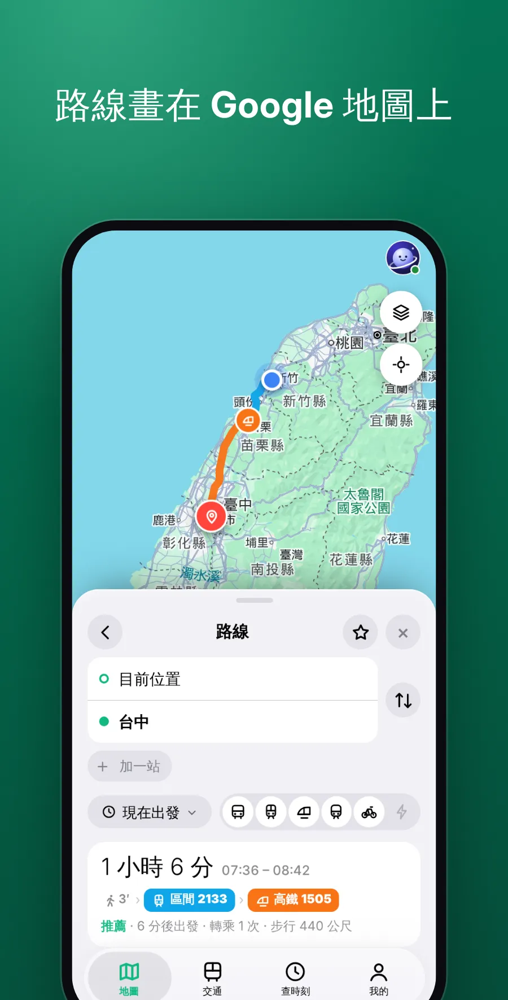
  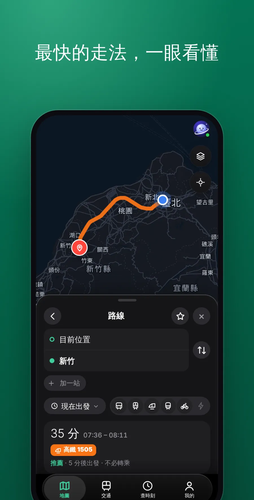
  
</p>

<p align="center">
  
  
  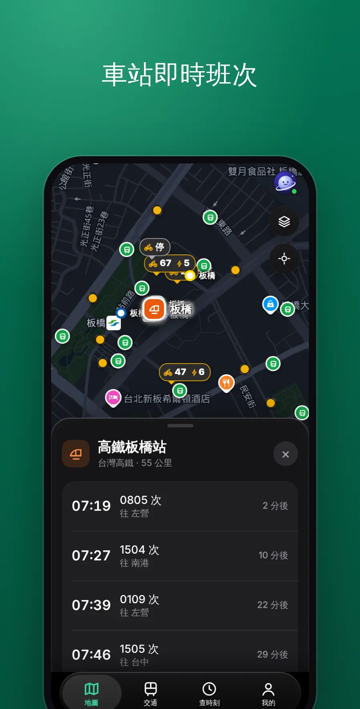
</p>

<p align="center">
  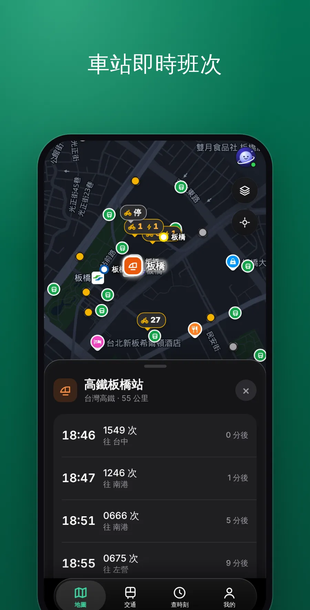
  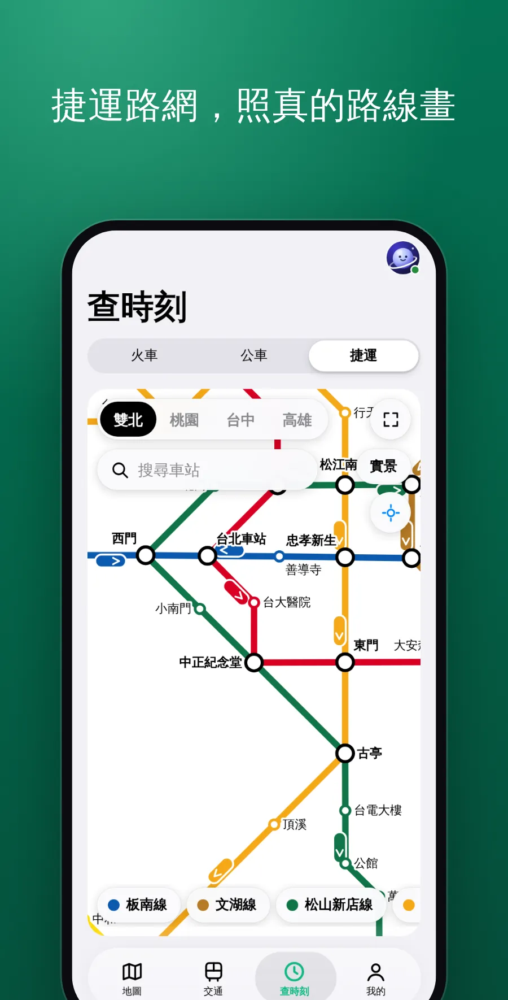
  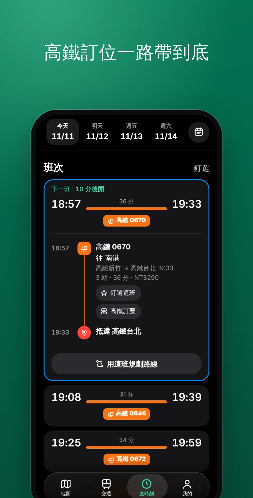
</p>

</details>

## Features

- **Orbit AI:** 用說的查路線: say where and when (明天早上八點從新竹車站到台北101); plain phrases are read by code, a time by AI, shown as understood before 看路線. 下雨改搭車: rain due on the way (from Orbit Weather, on the phone) puts a bus or the metro before a YouBike or a long walk, the wet legs marked with a drop. 這班為什麼慢: a late train's 晚 N 分 opens where it is and when it reaches you.
- **With the family:** a fare you set out on is offered to Orbit Money as a 交通 entry (車資記帳); other apps open a trip to a place (`#plan?to=`), and 問 Orbit's question opens 用說的查路線 asked.
- **Map:** every bus stop with live arrival times, YouBike stations with regular bikes, e-bikes (電輔車) and docks counted apart (the five nearest along the bottom), train and metro stations, search and your pins.
- **Trip planning** across bus, 台鐵, 高鐵, the metros and YouBike, ranked by door-to-door minutes and how much bother each way is, first plans in a second or two. There is always a recommendation.
- **建議 learns where you go:** a place you often go at about this hour comes up first as 常在這時候去.
- **Navigation** that follows the trip: every step moves on by itself, countdowns, the stops to go, a buzz before yours, the next bus if you miss one, and it survives the app being swiped away. One 出狀況 card covers a missed or late ride, no bikes, or the wrong bus, in any mode; plans already shown never change under you.
- **Timetables:** 台鐵 and 高鐵 station to station, stations picked on a train map (北部, 中部, 南部, 東部) or from nearby and recent ones, the picker showing only the line you chose (高鐵's one line, 南港 to 左營); every 台鐵 train says 準點, 晚 N 分 or 未發車 and opens in its own card; a bus route's fares between any two stops; bus routes and stops, and each city's metro drawn big and straight, full screen, with every station searchable and the trains arriving now.
- **高鐵訂票:** a 高鐵 ride opens 高鐵's own booking with the trip filled in, in the T Express app or on 高鐵's site.
- **YouBike rental timer** that warns before TPASS's free half hour runs out and offers docks nearby.
- **到站提醒:** "tell me when the 5608 is 5 minutes away", checked by the server while the phone is locked.
- **Service notices** from the operators themselves: a stopped line or route is marked and never planned.
- **Saved places and trips** (家, 學校, your own), synced through the Orbit Pass.
- **Every screen, either way up:** on a phone on its side, a tablet or a computer the map fills the screen with the trip as a panel at its left, and 交通 puts the trip card beside what's near.

## Tech stack

| Layer | What |
| --- | --- |
| App | Plain JavaScript (ES modules), HTML and CSS; no framework, no build step, no dependencies |
| Platform | Installable web app with a service worker; location and vibration for navigation, lock-screen notices while it runs |
| Shared | Look, Orbit Pass, notices and data reads from the kit in [Orbit-Core](https://github.com/JayPengX/Orbit-Core) |
| Data | The operators' own sources first, read by the phone where it can: 台鐵's open data and boards, 高鐵's timetable (GTFS), each city's bus site (臺北, 新北, 新竹, 桃園, 臺中, 臺南, 高雄, 公路局), the metros' own screens, YouBike's own list; TDX (Taiwan's transport data exchange) only as a backup, through the Orbit proxy on Cloudflare Workers; weekly bus packs from TDX's GTFS and line shapes in Cloudflare R2; 台鐵's track © OpenStreetMap contributors (ODbL), `public/rail-tra.json` |
| Maps | Google Maps under the month's cap, else Leaflet with NLSC's tiles; walks on Google's streets, else OpenStreetMap |
| Routing | Our own 台鐵/高鐵 router (Connection Scan) and metro router, beside Google's planner (TDX's planner is off since the move to its free tier) |
| Tests | `node --test`, including navigation driven fix by fix and the owner's verdicts on real trips |

## How it works

```
plan a trip
  ├─ Google's planner ┐
  │                  ├─► every way, re-timed by live bus estimates
  ├─ rail.mjs (CSA)   │
  └─ metro router     ┘
        ▼
  plan.mjs rank: 1. fold the ways a person wouldn't take
                 2. order the rest by minutes + a small table of bother
        ▼
  nav.mjs: the whole trip on the map, step by step, live
```

- **Costs in minutes, the way a person feels them:** a short wait at home counts a third, changing onto a train is easy and onto a bus a risk, YouBike past 30 minutes counts 4.5× per minute, walking is 5 km/h.
- **Planned once:** a saved trip's ways are kept and only re-timed; the billed planners are asked again only when the ways could differ.
- **What's near you** is worked out on the phone from R2 packs, not asked of a server.

The full map, the ranking rules and the decisions in force: **[MAP.md](MAP.md)**.

## Project structure

```
public/
├── index.html, app.mjs    the frame: Pass, tabs, location
├── transit.css            the app's look on top of the kit's
├── lib/                   42 modules
│   ├── planner.mjs, plan.mjs, live.mjs        planning, ranking, live re-timing
│   ├── rail.mjs, metro*.mjs                   train router; metro router, boards, maps
│   ├── bus.mjs, near.mjs, packs.mjs, shapes.mjs
│   ├── bike.mjs, rental.mjs, rivers.mjs, tpass.mjs
│   ├── nav.mjs, navlive.mjs, buzz.mjs, alerts.mjs
│   ├── service.mjs                            operators' notices as rules
│   └── tab-*.mjs, map.mjs, store.mjs          each tab; the map; the Pass's data
└── sw.js
scripts/                   live trips, verdicts, replays, metro maps
tests/                     node --test, with tests/verdicts/
MAP.md                     how it works, file by file
```

## Getting started

The app loads the shared kit from a sibling folder, so clone this repo next to [Orbit-Core](https://github.com/JayPengX/Orbit-Core):

```bash
git clone https://github.com/JayPengX/Orbit-Core.git
git clone https://github.com/JayPengX/Orbit-Transit.git
cd Orbit-Transit
```

Requirements: Node.js 22 or newer. There is nothing to install: no framework, no `node_modules`.

```bash
npm test   # links ../Orbit-Core/kit as .kit, then runs node --test
```

See it on a phone-sized screen, signed in with a made-up wallet and real data (needs Playwright):

```bash
# a screenshot, saved in /tmp/orbit-preview
node ../Orbit-Core/tools/preview.mjs transit --live --width 375
# serve it, then open http://localhost:8123/Orbit-Transit/
node ../Orbit-Core/tools/preview.mjs transit --live --serve --port 8123
```

`--dark`, `--lang en`, `--webkit` (Safari's engine) and the other flags are listed in [Orbit-Core/tools/README.md](https://github.com/JayPengX/Orbit-Core/blob/main/tools/README.md).

Run a trip on today's real data, and compare the ranking before and after a change:

```bash
node scripts/live.mjs 竹東站 縣體育場
node scripts/live.mjs --against HEAD
```

`scripts/replay.mjs` re-runs a debug log (`--why` shows each way's score) and `scripts/verdict.mjs` saves a new verdict.

## Deploying

Push to `main`. GitHub Actions runs the tests, stamps every file with its content hash (so a phone downloads only what changed) and publishes `public/` to Cloudflare at its orbit.jaypengx.com address (Orbit-Core `deploy/cf-site.mjs`). There are no pull requests or release branches.

## Part of Orbit

| App | What it is |
| --- | --- |
| [Orbit Sports](https://github.com/JayPengX/Orbit-Sports) | Every game you can watch in Taiwan, live |
| [Orbit Transit](https://github.com/JayPengX/Orbit-Transit) | Bus, train, metro and YouBike, planned and navigated |
| [Orbit Weather](https://github.com/JayPengX/Orbit-Weather) | One clear forecast, to the township |
| [Orbit Words](https://github.com/JayPengX/Orbit-Words) | English vocabulary that stays |
| [Orbit Securities](https://github.com/JayPengX/Orbit-Securities) | A Taiwan broker on play money |
| [Orbit Class](https://github.com/JayPengX/Orbit-Class) | Today's classes at a glance |
| [Orbit Beats](https://github.com/JayPengX/Orbit-Beats) | Endless music and your own beats |
| [Orbit Law](https://github.com/JayPengX/Orbit-Law) | Laws, rulings and bills, linked |
| [Orbit Money](https://github.com/JayPengX/Orbit-Money) | Your own books |
| [Orbit-Core](https://github.com/JayPengX/Orbit-Core) | The kit, the Orbit Pass and the Workers behind them all |

How it was all built, in pictures and numbers: [jaypengx.com/showcase](https://jaypengx.com/showcase/).
